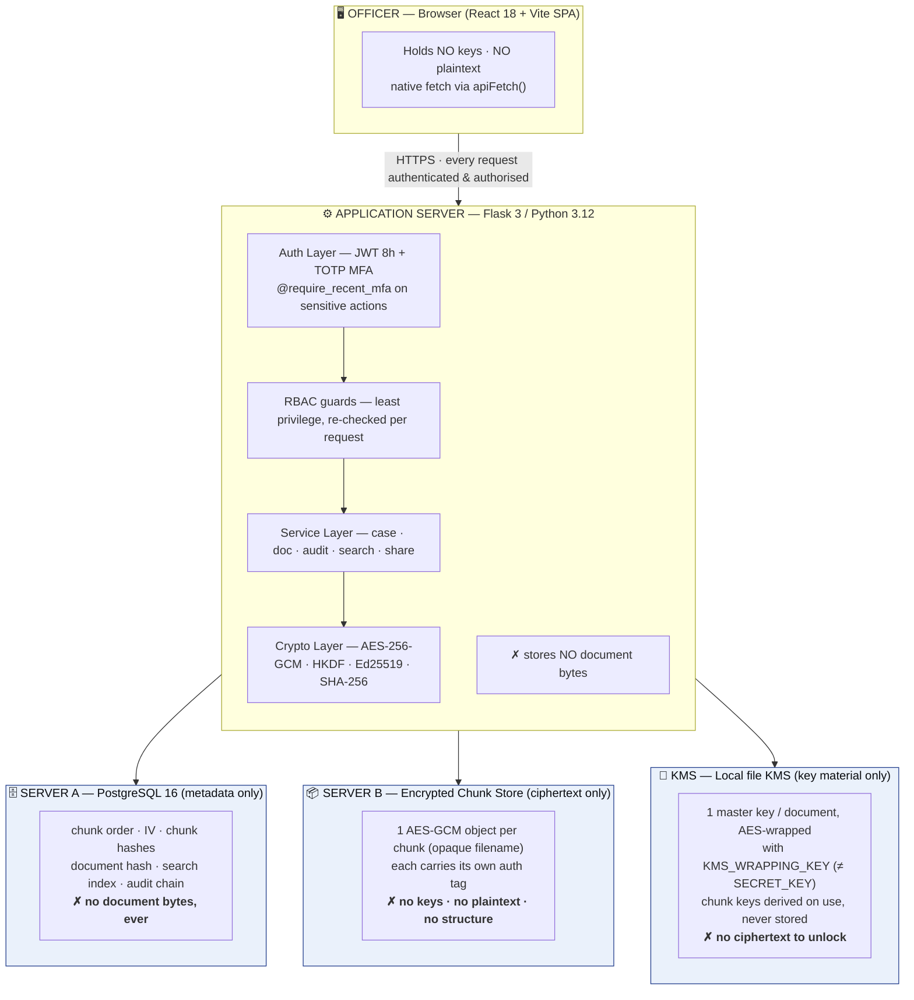
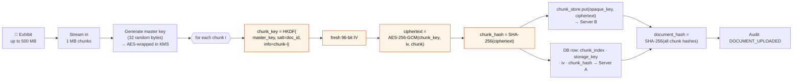
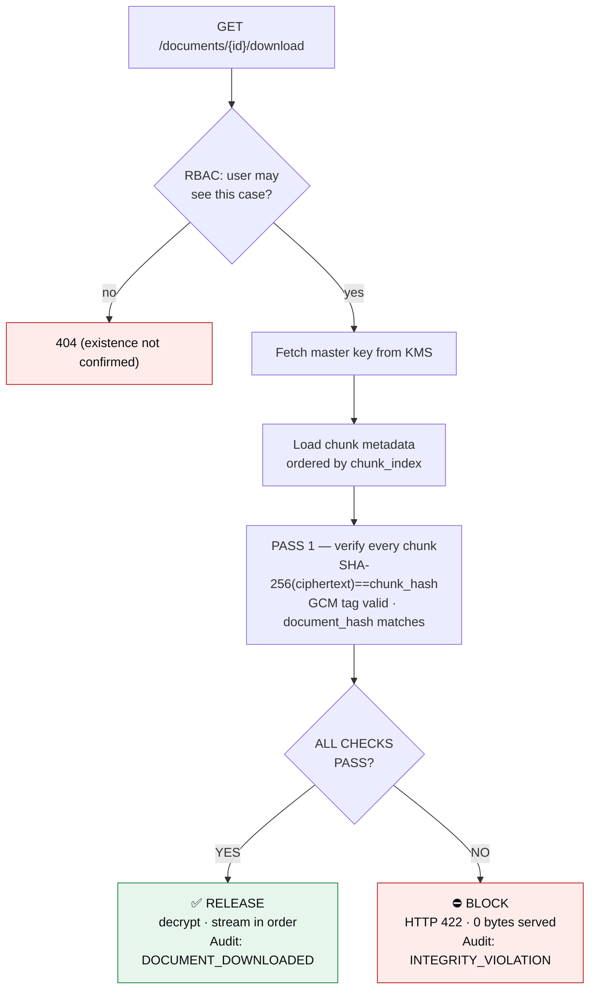
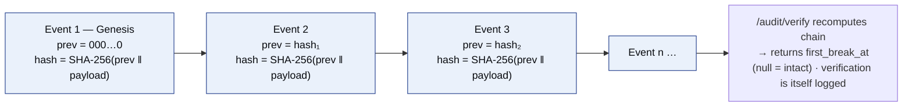
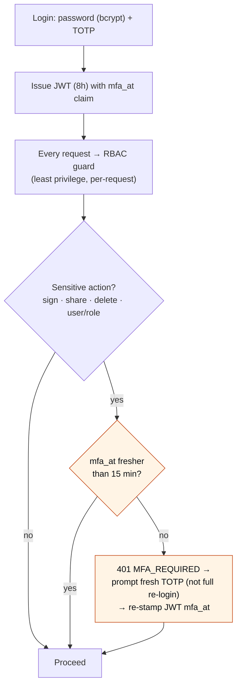
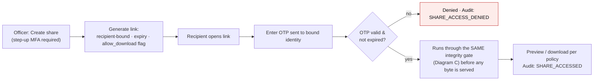

# PRAMAAN — System Diagrams & Technical-Approach Copy (PPT-ready)

*Companion to `winning-ppt-playbook.md`. Everything here is grounded in
`docs/ARCHITECTURE.md`, `docs/SECURITY.md` and `docs/THREAT_MODEL.md` — the numbers,
algorithms and flows are the real build, not marketing.*

**How to use the diagrams:** every diagram is given twice —
1. as a **Mermaid** block (paste into <https://mermaid.live>, export SVG/PNG, drop into the
   slide — clean vector, matches the deck's navy/blue palette), and
2. as **ASCII** (already-laid-out fallback for a text box or speaker reference).

Recommended slide-3 layout: **Diagram A (split-trust topology)** as the hero, with
**Diagram C (integrity gate)** inset bottom-right — that RELEASE/BLOCK decision is the
single most persuasive visual in the whole deck.

---

## Diagram A — Split-Trust System Topology (the hero diagram)

*The one-glance proof that no single machine can reconstruct a document.*



**ASCII fallback:**
```
        ┌───────────────────────────────────────────────┐
        │  OFFICER — Browser (React 18 SPA)             │
        │  holds NO keys · NO plaintext                 │
        └───────────────────────┬───────────────────────┘
                 HTTPS · every request authenticated & authorised
                                ▼
        ┌───────────────────────────────────────────────┐
        │  APPLICATION SERVER — Flask / Python 3.12     │
        │  Auth(JWT+TOTP) → RBAC → Services → Crypto     │
        │  AES-256-GCM · HKDF · Ed25519 · SHA-256        │
        │  ✗ stores NO document bytes                    │
        └─────────┬──────────────┬──────────────┬────────┘
                  ▼              ▼              ▼
        ┌──────────────┐ ┌──────────────┐ ┌──────────────┐
        │  SERVER A    │ │  SERVER B    │ │    KMS       │
        │  PostgreSQL  │ │ Chunk store  │ │ key material │
        │  metadata    │ │  ciphertext  │ │   only       │
        │  ✗ no bytes  │ │ ✗ no keys    │ │ ✗ no cipher  │
        └──────────────┘ └──────────────┘ └──────────────┘
   Any ONE compromised → useless. All THREE needed to read one document.
```

> **Speaker line:** *"Metadata, ciphertext, and keys live on three separate trust domains.
> Breach any one and you get nothing readable — you need all three at once."*

---

## Diagram B — Upload & Per-Chunk Encryption Pipeline

*Shows the core innovation: a fresh derived key per 1 MB chunk, streamed, never held whole.*



**Why it wins (say this):** *"One AES key never protects two chunks. Each chunk gets a key
derived by HKDF and a fresh 96-bit IV, so a nonce can never repeat under a key — the classic
GCM failure mode is designed out, not hoped away."*

**ASCII fallback:**
```
Exhibit (≤500MB) → stream 1MB chunks → master key (random, wrapped in KMS)
   for each chunk i:
     chunk_key = HKDF(master_key, salt=doc_id, info="chunk-i")
     iv = random 96-bit
     ciphertext = AES-256-GCM(chunk_key, iv, chunk)
     chunk_hash = SHA-256(ciphertext)
     → Server B: put(opaque_key, ciphertext)
     → Server A: {chunk_index, storage_key, iv, chunk_hash}
   document_hash = SHA-256(chunk_0_hash ‖ chunk_1_hash ‖ …)
   → Audit: DOCUMENT_UPLOADED
```

---

## Diagram C — The Integrity Gate: verify-before-release (the money shot)

*This is the demo. Evidence is NEVER streamed until every check passes.*



**Speaker line:** *"A tampered exhibit produces exactly zero downloaded bytes. The system
refuses to release evidence it cannot verify — and it records the refusal."*

**ASCII fallback:**
```
 download request
      │
  RBAC check ──no──► 404 (never confirm the file exists)
      │yes
  fetch master key → load chunks (by index) → PASS 1: verify ALL
      │                                    (chunk hash · GCM tag · document hash)
      ▼
 ┌─────────── ALL CHECKS PASS? ───────────┐
 │YES                                   NO│
 ▼                                        ▼
 ✅ RELEASE                            ⛔ BLOCK
 decrypt · stream in order            HTTP 422 · 0 bytes
 Audit: DOCUMENT_DOWNLOADED           Audit: INTEGRITY_VIOLATION
```

---

## Diagram D — Tamper-Evident Audit Hash-Chain

*Each event hashes the previous one; any edit breaks every hash after it.*



**Precise wording (matches CLAUDE.md terminology):** *"hash-chained, tamper-**evident** — we
**detect** modification, we do not claim it's impossible. DB-level `REVOKE UPDATE, DELETE`
closes the easy path; the chain catches the rest."* **Never say "blockchain" or "immutable."**

---

## Diagram E — Auth, RBAC & Step-Up MFA (defence in depth)



---

## Diagram F — Secure Share: recipient-bound, OTP-gated, time-limited



---

## Technical-Approach copy — drop-in bullet text for Slide 3

*Written in the winning "**bold term:** benefit" style from the playbook (§1.2). Trim to fit.*

**Architecture — split trust, one document end-to-end**
- **Two-server topology:** metadata (PostgreSQL) and ciphertext (chunk store) live on
  separate machines; keys live in a third KMS domain — no single host can reconstruct a file.
- **Per-chunk encryption:** every 1 MB chunk gets an HKDF-derived key + fresh 96-bit IV under
  AES-256-GCM — one key never covers two chunks.
- **Opaque storage keys:** chunk filenames are random tokens; Server B holds no document IDs,
  no order, no keys — just authenticated ciphertext.
- **Verify-before-release:** every chunk hash, every GCM tag and the document hash are checked
  *before* a single byte is streamed; failure returns HTTP 422 and serves 0 bytes.
- **Tamper-evident audit:** a SHA-256 hash-chain logs every action; `/audit/verify` names the
  first broken event; DB-level `REVOKE UPDATE, DELETE` blocks the easy edit path.
- **Least-privilege access:** six roles, RBAC re-checked on every request; case-scoped
  resources return 404 (never 403) so existence is never confirmed.
- **Step-up MFA:** TOTP at login, plus a fresh TOTP re-check before sign / share / delete /
  user-role changes.

**Technologies used** (render the marks as a grouped logo wall — playbook §1.4)
- **Frontend:** React 18 · Vite · TypeScript · Tailwind
- **Backend:** Python 3.12 · Flask 3 · SQLAlchemy · Flask-Migrate · JWT · marshmallow
- **Data:** PostgreSQL 16 (metadata, full-text search, audit chain) · encrypted chunk store
- **Crypto:** AES-256-GCM · HKDF-SHA256 · SHA-256 · Ed25519 · bcrypt · TOTP *(pyca/cryptography — audited, no hand-rolled crypto)*
- **OCR:** Tesseract (offline · English + Hindi/Tamil/Telugu/Bengali/Gujarati)
- **Production swap-ins:** MinIO (chunk store) · HashiCorp Vault (KMS) · Redis · Celery · Nginx+TLS — all behind existing interfaces

**Methodology (one line):** *Threat-model first → write the spec → implement against audited
libraries → verify integrity before every release → log every action to a verifiable chain.*

---

## Guardrails when you write these into the deck
- Use **"tamper-evident,"** never "immutable" / "blockchain."
- Use **"least-privilege,"** never "zero-trust."
- Say **"chunk store (local disk; MinIO in production),"** not "MinIO" as if it exists now.
- Say **"cryptographically signed; legal admissibility is out of scope."**
- **PRAMAAN is standalone** — no comparison to ICJS / eSakshya / CCTNS / CCTNS-like systems.
- Numbers on the impact slide are **targets measured from the prototype**, not claims.
